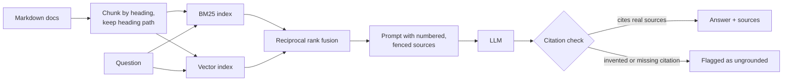

# rag-knowledge-assistant

A retrieval-augmented question-answering pipeline built from its parts: heading-aware chunking, BM25 and vector retrieval fused with reciprocal rank fusion, answers that must cite their sources, and an evaluation suite that scores retrieval against labelled questions.

It runs fully offline. The only dependency is NumPy.

## Pipeline



## Evaluation

`python -m ragkit eval` on the bundled corpus: 10 short handbook documents (30 chunks) and 28 questions, each labelled with the document and the exact phrase that answers it.

| Retriever | Recall@1 | Recall@3 | Recall@5 | MRR |
|---|---:|---:|---:|---:|
| BM25 (keywords) | 0.857 | 0.964 | 0.964 | 0.905 |
| Dense (hashed n-grams) | 0.786 | 0.964 | 1.000 | 0.882 |
| Hybrid (RRF of both) | 0.893 | 0.964 | 0.964 | 0.929 |

Hybrid retrieval puts the right chunk first more often than either method alone, which is the usual reason to combine them.

**Read these numbers with care:**

- **The corpus is small and written for this repo.** The handbook is for a made-up company. Thirty chunks is an easy haystack; these scores say the pipeline is wired correctly, not how it would do on a large real corpus.
- **The "dense" retriever is not a neural model.** `HashingEmbedder` hashes character n-grams, so it matches on spelling. It handles typos and word variants ("reimbursment" finds "reimbursed") but does not know that "vacation" means "leave". A real embedding model plugs in through the `Embedder` protocol and should do better on paraphrased questions.
- **A test fails the build if hybrid recall@3 drops below 0.95 or MRR below 0.90**, so retrieval changes are checked against the question set rather than by eye.

### Answers

No language model runs in this repo by default. `ExtractiveLLM` is an offline stand-in that returns the single source sentence sharing the most words with the question. On the 28 questions it includes the correct fact 75% of the time and cites the correct document 93% of the time.

That baseline is deliberately naive. It answers "How do I reset the office wifi router?" with a sentence about office days, because the word "office" matched. Knowing when the sources do not contain the answer is the part that needs a real model, and `ragkit/llm_anthropic.py` is an adapter for one. That adapter needs an API key and is not exercised by the tests.

## Design decisions

- **Chunk on headings, and keep the heading with the chunk.** A paragraph that says "stays are capped at 7,000 rupees" is only findable for a question about hotels if the chunk carries its "Travel" heading.
- **Fuse by rank, not score.** BM25 scores and cosine similarities are on different scales. Reciprocal rank fusion needs no weights to tune.
- **Sources are numbered and fenced in the prompt**, and the model is told to refuse when they do not contain the answer.
- **Citations are verified.** `check_citations` rejects an answer that cites `[7]` when four sources were given, or that cites nothing. Such answers are returned with `grounded=False` so the caller can decide what to show.

## Use it

```python
from ragkit import HybridRetriever, RagPipeline, ExtractiveLLM
from ragkit.evaluate import load_corpus

pipeline = RagPipeline(HybridRetriever(load_corpus("corpus")), ExtractiveLLM(), k=4)
answer = pipeline.ask("How long is the probation period?")
answer.text        # "The probation period is 3 months. [1]"
answer.citations   # [Chunk(source="10-onboarding.md", heading="Onboarding > Probation", ...)]
answer.grounded    # True
```

```bash
pip install -e ".[dev]"
pytest -q                                   # 11 tests
python -m ragkit eval
python -m ragkit ask "What error rate triggers a rollback?"
```

## What is missing

A reranker, query rewriting, metadata filters, incremental indexing, and an answer-quality evaluation with a real model (faithfulness and relevance). Vector search here is exact, which is right for thousands of chunks and wrong for millions.
